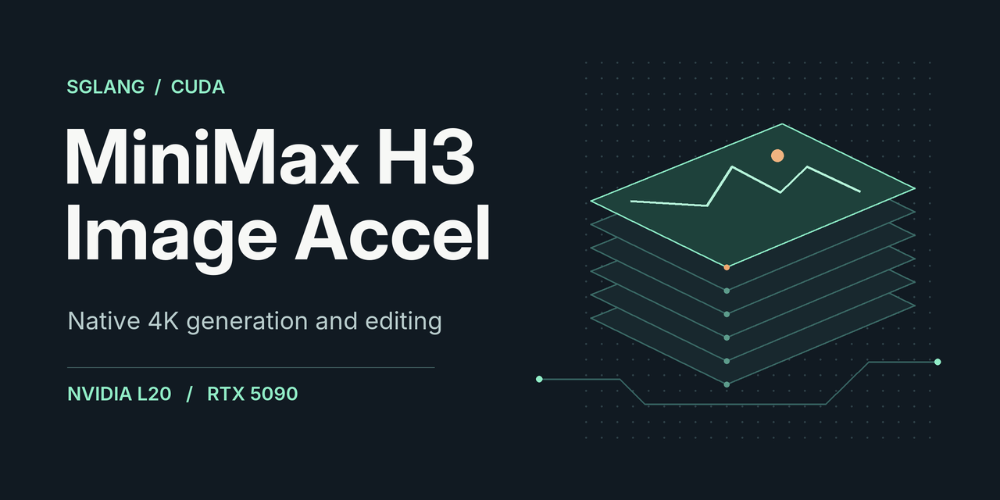
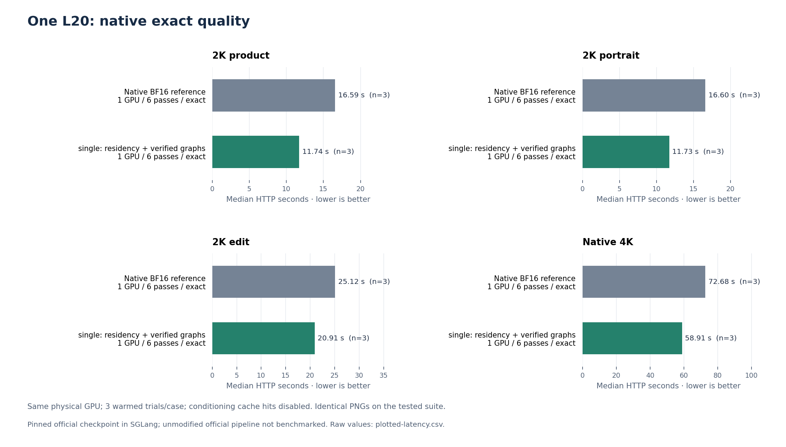
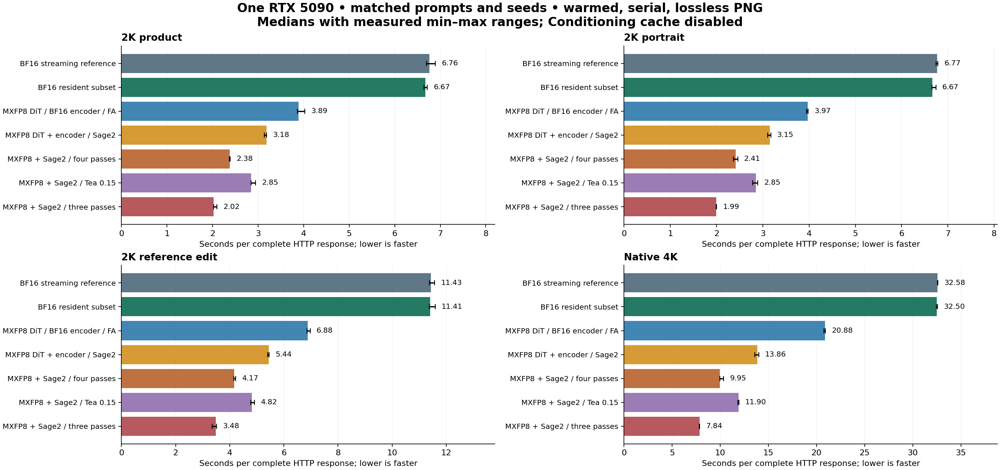
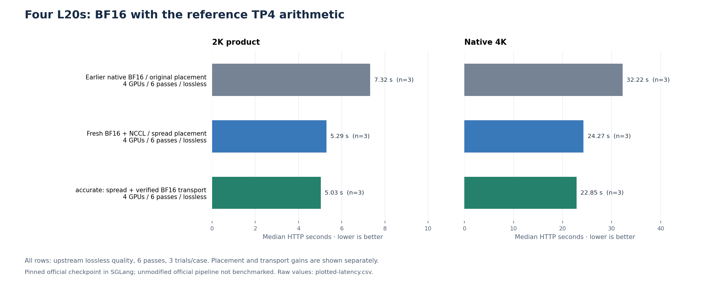
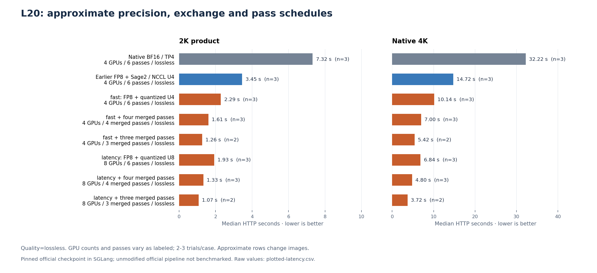
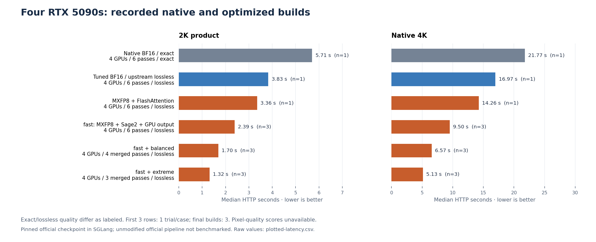
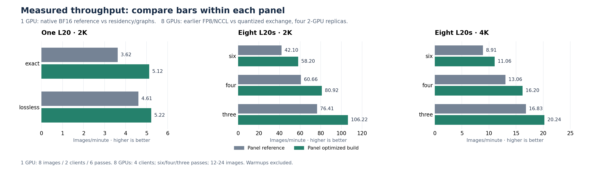

# MiniMax-H3-Image-Accel



Run **MiniMax-H3-Image on a single L20 or RTX 5090**, or spread inference across multiple GPUs. The SGLang runtime supports native 4K generation and reference-image editing. Start with BF16 and all six native denoising passes. Opt into FP8 and shorter schedules when you want to trade reference fidelity for lower latency.

[Benchmark results](#benchmark-results) · [Image comparisons](#image-comparisons) · [Quickstart](#quickstart) · [Runtime guide](docs/runtime.md) · [Releases](https://github.com/devin-lai/MiniMax-H3-Image-Accel/releases)

## Benchmark results

On one L20, the BF16 `single` profile cut 2K product latency by **29%**, with byte-identical PNGs across the eight audited native-`exact` pairs. On one RTX 5090, the opt-in MXFP8/SageAttention2 profile ran native 4K in **13.86 s**, a **2.35× speedup** over BF16 streaming. MXFP8 changes the generated image for the same seed. [Benchmark data and methodology](docs/benchmarks/README.md)

### Latency

Each row compares six-pass builds using the same GPU count and request quality preset. Times are medians of three warmed serial HTTP requests per case. References are the native or earlier builds in the pinned SGLang runtime.

| Hardware | Reference → optimized | Quality | 2K product | Native 4K |
| --- | --- | --- | ---: | ---: |
| **1 × L20** | Streamed BF16 → BF16 residency and VAE replay | `exact` | 16.59 → **11.74 s** | 72.68 → **58.91 s** |
| **4 × L20** | BF16/NCCL → verified BF16 host transport, same PCIe placement | `lossless` | 5.29 → **5.03 s** | 24.27 → **22.85 s** |
| **4 × L20** | Earlier FP8/SageAttention2 with NCCL → FP8 with quantized exchange | `lossless` | 3.45 → **2.29 s** | 14.72 → **10.14 s** |
| **1 × RTX 5090** | Streamed BF16 → MXFP8/SageAttention2 | `lossless` | 6.76 → **3.18 s** | 32.58 → **13.86 s** |

[](docs/benchmarks/single-exact.png)

[L20 and four-RTX-5090 latency CSV](docs/benchmarks/latency.csv) · [Single-RTX-5090 latency CSV](docs/benchmarks/single-rtx5090-latency.csv)

<details>
<summary>More latency charts for L20 and RTX 5090</summary>

**One RTX 5090.** The chart shows the BF16, MXFP8, and reduced-pass builds, with min–max ranges across the timed requests.

[](docs/benchmarks/single-rtx5090.png)

**Four L20s with BF16.** The first two bars show the original and spread PCIe placements. The last two bars hold placement fixed to isolate the transport change. All 12 matched PNG pairs from the fresh NCCL and verified-host runs had identical bytes. [BF16 output checks](docs/benchmarks/README.md#bf16-output-checks)

[](docs/benchmarks/l20-accurate.png)

**Approximate L20 profiles.** The chart labels GPU count and pass count for the FP8 and merged-pass experiments.

[](docs/benchmarks/l20-fast.png)

**Four RTX 5090s.** The chart labels the BF16 `exact` and `lossless` runs, the MXFP8 profiles, and the number of trials for each case.

[](docs/benchmarks/rtx5090.png)

</details>

### Throughput

At six passes, one L20 completed **3.62 → 5.12 images/min** at 2K with two queued clients in `exact` mode. Across eight L20s, four two-GPU FP8 replicas completed **42.10 → 58.20 images/min** at 2K after the exchange optimization. The single-RTX-5090 run went from **8.72 → 18.17 images/min** with MXFP8/SageAttention2 across six requests from one client. [L20 throughput CSV](docs/benchmarks/throughput.csv) · [RTX 5090 throughput CSV](docs/benchmarks/single-rtx5090-throughput.csv)

[](docs/benchmarks/throughput.png)

## Choose a profile

| Hardware | Start here | What it does |
| --- | --- | --- |
| **1 × NVIDIA L20** | `single` | Keeps most of the encoder and the VAE in VRAM. Streams the DiT and checks CUDA graph output against eager decoding before replay. |
| **1 × RTX 5090** | `single` | Keeps a subset of BF16 DiT blocks in VRAM and prefetches the remaining layers from host RAM. |
| **4 × L20 or RTX 5090** | `auto` | Uses BF16 tensor parallelism (TP4) and dense FlashAttention. On L20, eligible host reductions are checked against NCCL before use. |
| **When latency or throughput comes first** | `single-fast`, `fast`, `latency`, `throughput` | Opt-in FP8 or MXFP8 with SageAttention2. These profiles can change the output for the same seed. |

`accurate` is an alias for `auto`. If TP4 cannot fit, `auto` can fall back to an idle L20. Use `single` explicitly on one RTX 5090. [Full profile matrix](docs/runtime.md#gpu-profiles)

## Quickstart

You’ll need a **Linux x86-64 host**, a CUDA 13.0-compatible NVIDIA driver, a C++20 compiler, and storage for **126.08 GiB of model files** plus the environment and caches. Single-GPU profiles also use host RAM for offload. The checkpoints come from Hugging Face under their own territory and use restrictions. [MiniMax-H3-Image license](https://huggingface.co/MiniMaxAI/MiniMax-H3-Image/blob/main/LICENSE) · [Install requirements](docs/runtime.md#requirements)

```bash
git clone https://github.com/devin-lai/MiniMax-H3-Image-Accel.git
cd MiniMax-H3-Image-Accel
bin/install.sh
bin/download.sh
```

Start the profile for your hardware. Run one of these commands.

```bash
# Four GPUs, with a single-L20 fallback
bin/start_profile.sh auto

# One L20 or RTX 5090
H3_GPUS=0 bin/start_profile.sh single
```

When `bin/h3ctl status` reports a healthy server, generate a seeded image.

```bash
.venv/bin/python bin/generate.py \
  "An editorial photograph of a cobalt perfume bottle on pale stone" \
  --size 2048x2048 --seed 731 --profile six --quality exact \
  --output generated/bottle.png
```

Use `--size 4096x4096` for native 4K or pass `--image` for reference editing. The CLI saves a PNG and a JSON record of the request. [Edit example and HTTP API](docs/runtime.md#generate-and-edit)

## Image comparisons

The benchmark edit case in a fresh checkout uses this geometric input. The matched-run tools build side-by-side frames, 1:1 crops, and pixel statistics from your own baseline and optimized runs. [Build an image stack](docs/benchmarking.md#build-an-image-stack) · [Edit prompt](examples/edit-prompt.txt)

<a href="examples/edit-reference.png"></a>

## Benchmark your GPU

Compare two configurations with the same prompt, seed, resolution, GPU layout, and quality preset. The benchmark tools record warmed HTTP latency, concurrent images per minute, and per-image hashes. The accuracy audit reports PNG byte equality and can require identical decoded pixels or enforce PSNR and SSIM thresholds per image. [Run a matched benchmark](docs/benchmarking.md)

## Explore the source

| Path | Contents |
| --- | --- |
| [`bin/`](bin/) | Install, serve, generate, benchmark, and compare |
| [`configs/`](configs/) | Request profiles, example payloads, and pinned checkpoint hashes |
| [`tests/`](tests/) | Profile selection, image comparison, and CUDA correctness tests |
| [`vendor/`](vendor/) | H3 inference patch for pinned SGLang, SageAttention sources, and optional SageAttention3 build headers |

Reproductions on different GPU layouts and focused fixes are welcome. [Contributing guide](CONTRIBUTING.md) · [GitHub Issues](https://github.com/devin-lai/MiniMax-H3-Image-Accel/issues)

## License

Project code is available under [Apache 2.0](LICENSE). Vendored components retain their licenses, and the MiniMax checkpoints are governed by their own agreements. [Third-party notices and model licenses](THIRD_PARTY_NOTICES.md)
