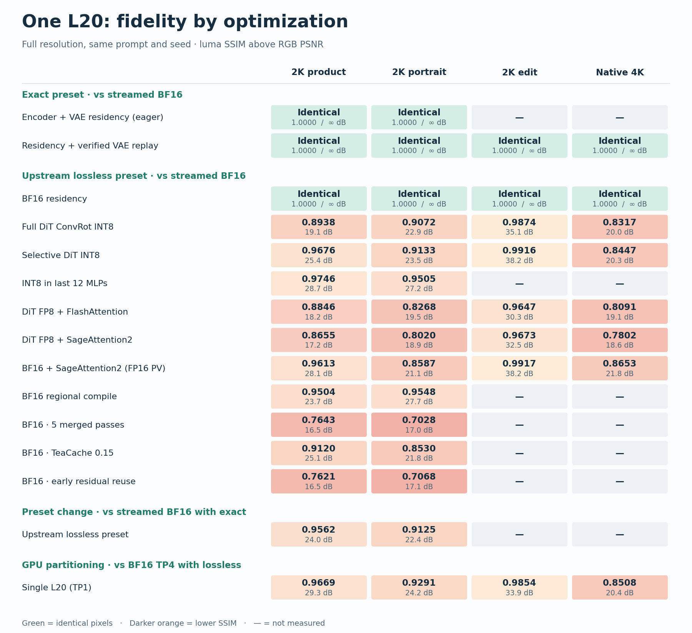
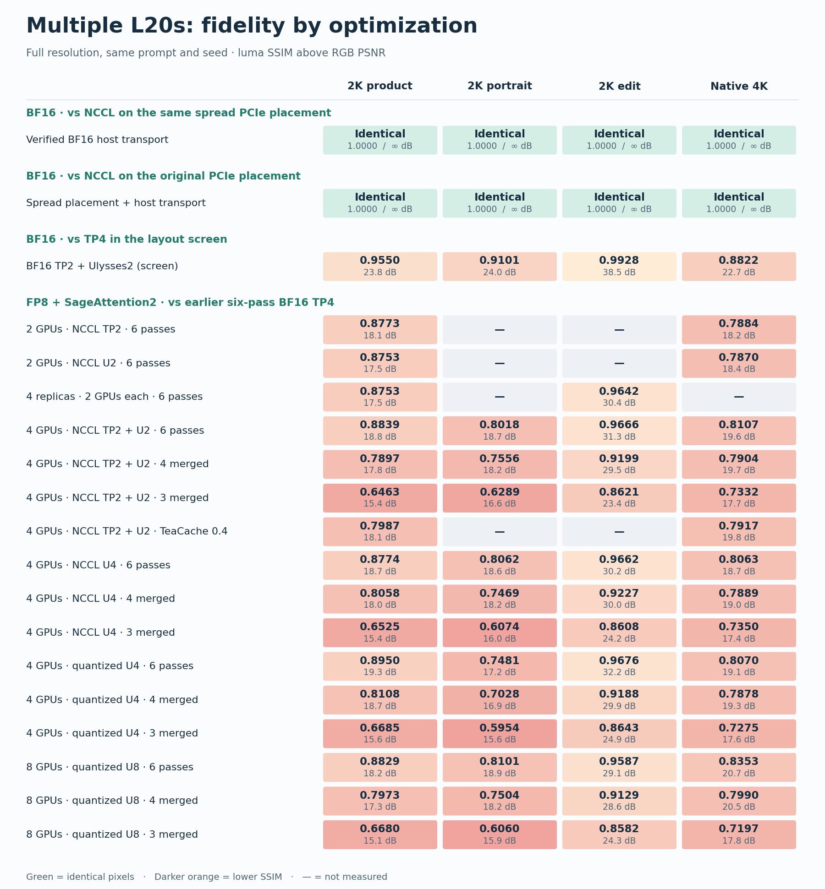
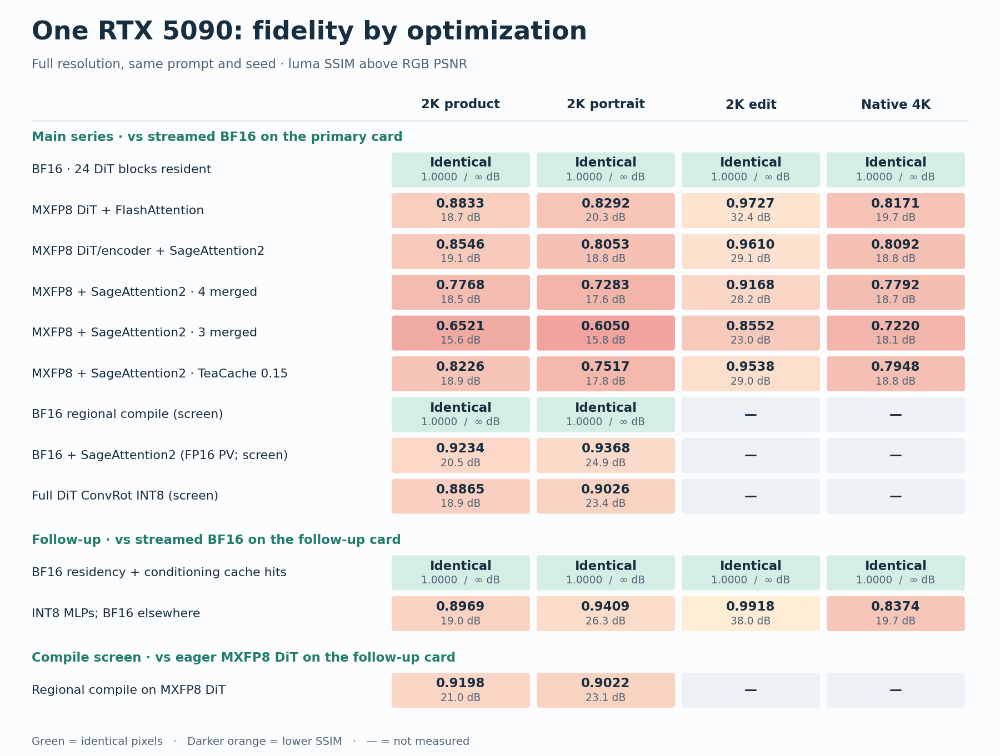
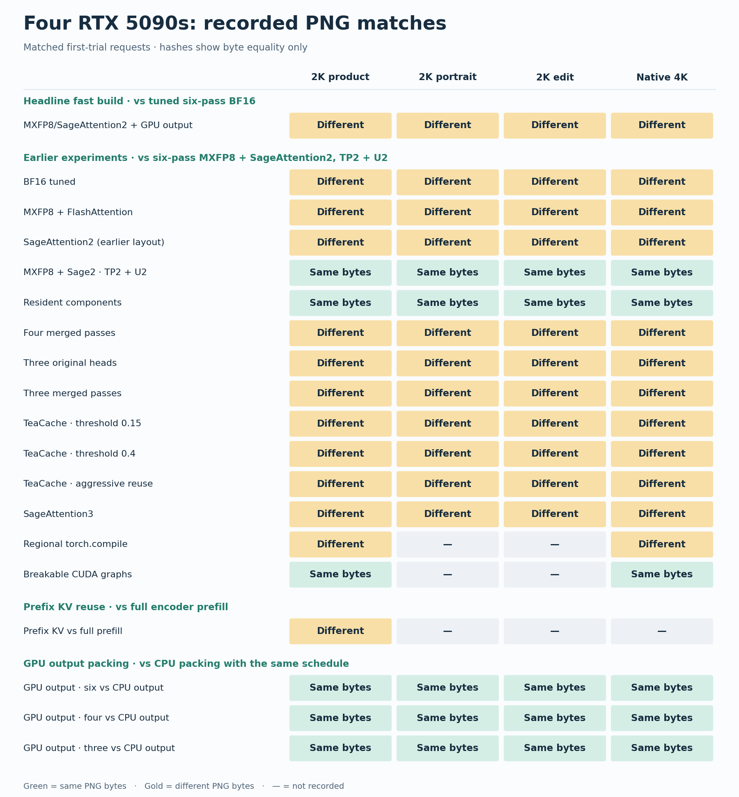

# Image fidelity by optimization

[Headline speedups](../../README.md#benchmark-results) · [Timing charts and data](README.md) · [Per-image fidelity CSV](fidelity.csv)

Each panel names its reference. Read across a row to see how an optimization affected 2K product typography, portrait, reference editing, and native 4K still life. The charts use the same primary seed per workload and report full-resolution luma SSIM (top) and RGB PSNR in dB (bottom). The CSV includes additional audited seeds where available.

**Green means identical pixels** (SSIM 1.0000, PSNR ∞). Darker orange means lower SSIM; a dash means the case was not measured. The project's near-identical check requires **both SSIM ≥ 0.99 and PSNR ≥ 40 dB** on every case. These scores measure similarity to the named seeded reference. They do not score prompt adherence or visual quality. Rows that change several settings measure the whole build; differences between scores cannot be added up or attributed to individual components.

## One L20

The final BF16 `single` build matched **8/8 PNGs** with `exact` and **12/12** against its separate `lossless` reference. In the same-card ablation, replay saved **0.18 s for product** and **0.21 s for portrait** over eager decoding with the same residency policy. Both paths matched the reference PNGs in those two cases. [Native exact timing](single-exact.png)

Among the `lossless` experiments, selective INT8 reached **7.71 s** at 2K product and **43.06 s** at 4K. DiT FP8 with SageAttention2 reached **6.93 s / 34.59 s**, with lower SSIM on the tested portrait and 4K case. The two bottom panels show why changes to the request preset or GPU partition also need their own reference. [Exploratory timing chart](single-l20-tradeoffs.png)

## Multiple L20s

Verified BF16 host transport matched **12/12 PNGs** with NCCL at the same PCIe placement. The optimized build also matched the four audited outputs from the earlier BF16 placement. The BF16 TP2 + Ulysses2 experiment changed the output, so the accuracy profile keeps TP4. [BF16 timings](l20-accurate.png)

The FP8 rows compare against the earlier four-L20 BF16/TP4 output; U2, U4 and U8 denote the Ulysses degree. The table isolates the choice of pass schedule within the four-L20 quantized-exchange build. [FP8 timings](l20-fast.png)

| Schedule | 2K product | Native 4K | Native 4K SSIM vs. BF16 |
| --- | ---: | ---: | ---: |
| 6 native passes | 2.29 s | 10.14 s | 0.8070 |
| 4 merged passes | 1.61 s | 7.00 s | 0.7878 |
| 3 merged passes | 1.26 s | 5.42 s | 0.7275 |

## One RTX 5090

The primary `lossless` series compared against streamed BF16 with conditioning cache hits disabled. BF16 DiT residency matched **12/12 PNGs**, with little change in warmed latency. MXFP8 with SageAttention2 cut native 4K latency from **32.58 s to 13.86 s**; four and three merged passes cut it further to **9.95 s** and **7.84 s**, with lower 4K SSIM. [Primary timing chart](single-rtx5090.png)

The follow-up used a different physical RTX 5090 and its own streamed BF16 control. For 2K product, BF16 residency with conditioning cache hits went from **6.81 s to 5.72 s** with matching PNGs. That gain applies to repeated prompts. INT8 limited to the MLPs took **5.08 s** and changed the output. The compile panel compares compiled MXFP8 directly with eager MXFP8: the two screened cases changed pixels with less than 0.5% latency improvement. [Follow-up and screen timings](latency.csv)

## Four RTX 5090s

Only recorded hashes are available for this series. The headline six-pass MXFP8 build differed from tuned BF16 on all four workloads. Earlier experiments use the six-pass MXFP8/SageAttention2 build as their reference. Prefix KV and GPU output packing use their own matched controls. A different hash means the PNG bytes differ; these records cannot quantify pixel loss.

The GPU output packing change matched **36/36 repeated PNGs** against CPU output packing at the corresponding schedule. The chart shows the first trial for each workload. That check establishes output parity for packing, separately from the choice of precision or schedule. [Hash records and reference IDs](quad-rtx5090-png-hashes.csv) · [Latency chart](rtx5090.png)

For visual inspection of your own outputs, [build a matched image stack](../benchmarking.md#build-an-image-stack) to review full frames and the same detail crops side by side.
